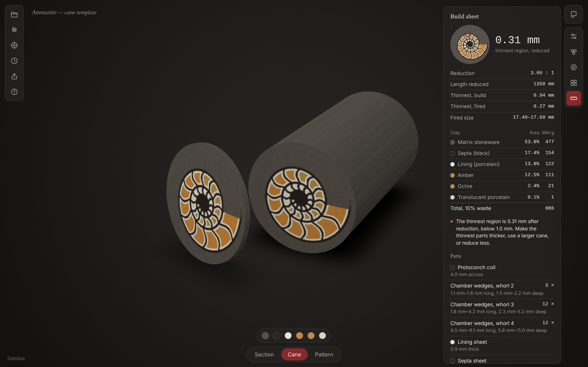
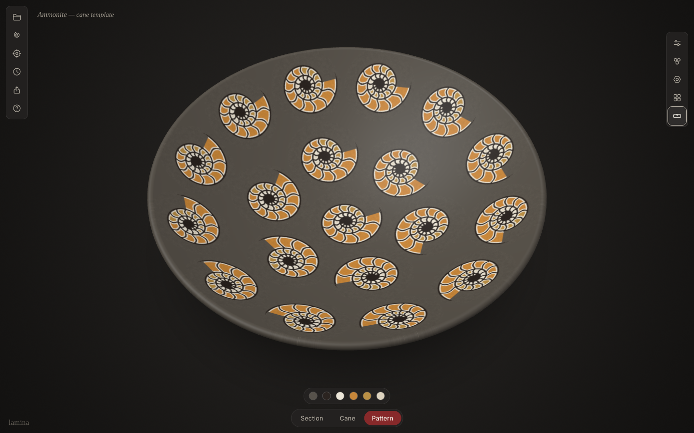
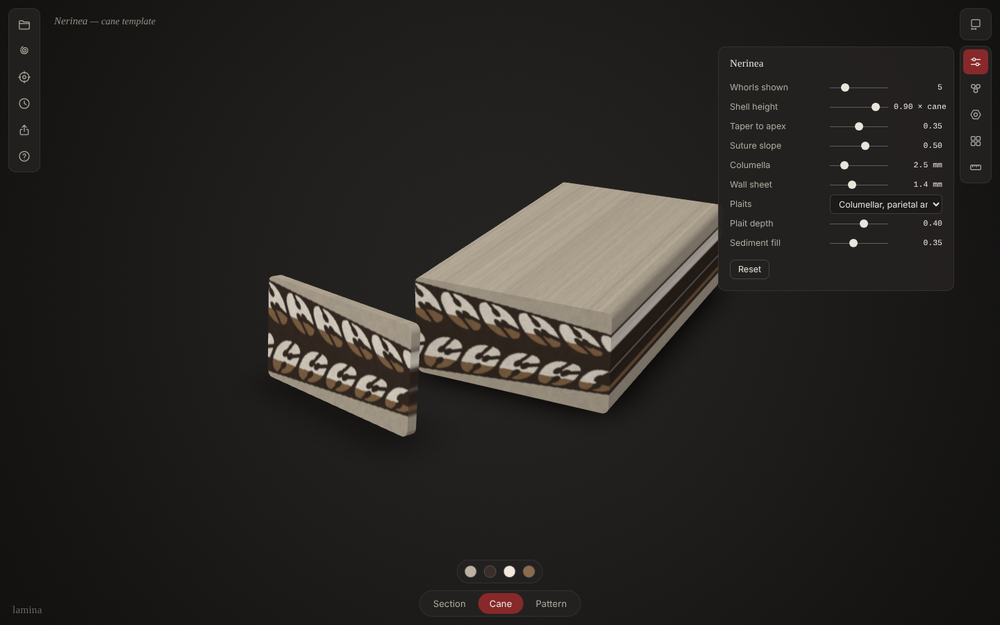
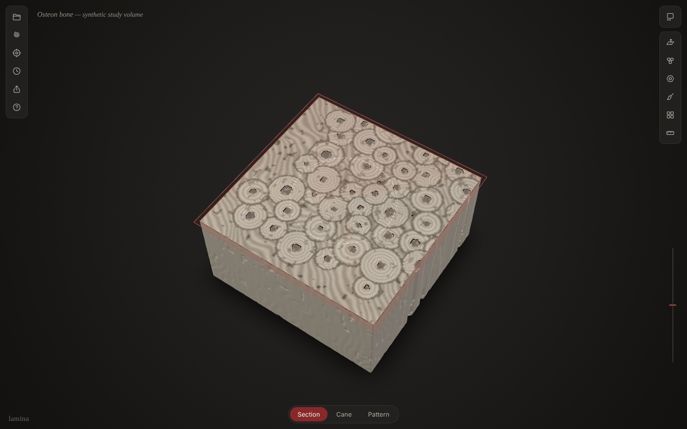

# lamina

Design nerikomi clay canes from fossils. Load a CT scan / 3D model / photo of a polished section, or start from a fossil template; cut a section; choose clays; print a 1:1 build sheet with grams per clay, every part & its size, and a shrinkage check.



**[open lamina →](https://salma2vec.github.io/lamina/)** runs in the browser; nothing to install, no account, files never leave your machine.

I made this for my own ceramics: nerikomi pieces built from fossil structure (bone osteons, ammonite septa, stromatolite layers). In nerikomi the pattern runs through the clay the way structure runs through a fossil, so a section through a specimen maps onto a cane quite directly.

## how it works

```
scan / mesh / photo / template
   │  cut a plane at any angle
   ▼
section
   │  2–6 clays; anything too thin to build is merged away
   ▼
cane ──► reduce, slice, tile ──► pattern on a slab or bowl
   │
   ▼
build sheet: 1:1 SVG, grams per clay, parts & steps, fired size
```

Three views: **Section** (specimen in 3D, cut face exposed), **Cane** (a clay log w/ one slice cut off), **Pattern** (slices on a slab or bowl). Controls sit in small panels at the screen edges and stay shut until you need them. Section & Cane also have a flat view w/ scale bar, for measuring. `?` lists every key.

## templates

Some fossils are better drawn than scanned. A template builds the section from a few measurements and writes the assembly too: which sub-canes, what size, in what order.

| | |
|---|---|
|  | **ammonite**: logarithmic spiral of chambers. Each chamber is a tapered wedge wrapped in a lining sheet + a septa sheet, laid around a protoconch coil smallest to largest, then wrapped in matrix. Params: whorls, chambers/whorl, sheet thicknesses, septa curve, body chamber, fill order. |
|  | **nerinea**: lengthwise section of a high-spired Mesozoic gastropod. Whorl chambers on both sides of the columella; columellar / parietal / palatal folds; a level sediment line in each chamber (geopetal). Params: whorls, taper, suture slope, plaits, plait depth, sediment level. |

Geometry, build steps & how to add your own: [docs/TEMPLATES.md](docs/TEMPLATES.md).

## study volumes & daily practice



Five synthetic volumes ship w/ it: osteon bone, ammonite, stromatolite, petrified wood, Ediacaran frond. Generated in the browser from a fixed seed; labelled as synthetic.

**Today** gives everyone the same specimen & section each day. Set a timer, design the cane by hand, then reveal lamina's version.

## real data

MorphoSource, Smithsonian 3D, Dryad, Zenodo et al. have open scans; each record carries its own licence, and some forbid commercial use (matters if you sell the work). Where to look, converting DICOM, crediting a specimen: [docs/DATA.md](docs/DATA.md).

| kind | files | notes |
| --- | --- | --- |
| mesh | `.stl` `.ply` `.obj` | binary/ASCII; polygons triangulated; units taken as mm (changeable) |
| volume | `.nrrd` | raw/gzip; voxel size from `space directions` / `spacings` in `space units` |
| volume | `.tif` stack | 8/16/32-bit, uncompressed/LZW/PackBits; voxel size from ImageJ metadata or resolution tags |
| volume | `.png` `.jpg` `.tif` slices | one file per slice, natural sort (`s2` before `s10`) |
| image | one `.png` `.jpg` `.webp` `.tif` | a photographed section; straight to the cane; set pixel size for mm |
| session | `.json` | parameters + a reference to the source; never the data itself |

Volumes are cut to ≤256 voxels a side in a worker; intensities clipped to the 0.1–99.9 percentile.

## the numbers

*D* build size (mm) · *L* build length (mm) · *d* reduced size (mm) · *ρ* wet density (g/cm³, default 1.9) · *w* waste (%, default 10) · *sᵢ* shrinkage of clay *i* (%) · *fᵢ* its share of the section · *A* outline area

```
R          = D / d                                  reduction ratio
L_reduced  = L · R²                                 volume is conserved
mᵢ         = fᵢ · A · L / 1000 · ρ · (1 + w/100)    grams of clay i
t_reduced  = t_build / R                            thinnest region after reduction
fired_i    = d · (1 − sᵢ/100)
```

*t* = diameter of the largest circle inside the narrowest clay region (exact Euclidean distance transform). Warnings: *t_reduced* < 1 mm; clays in use differ in shrinkage by > 1.5 points. The 1.5 is my working default; no published standard sets it.

The printed sheet carries a 100 mm ruler; measure it after printing. Chrome prints it within 0.01 mm on A4 & Letter.

Building the cane from the sheet, measuring your own shrinkage & density, clay compatibility, translucency, safety: [docs/CERAMICS.md](docs/CERAMICS.md).

## under the hood

- plain HTML/CSS/ES modules; no build step, no framework, no network requests at runtime. three.js & UTIF vendored.
- parsing, downsampling, synthetic volumes & surfaces run in workers, w/ progress + cancel. A 210 MB TIFF stack loads in ~3 s.
- mesh sections: exact plane–triangle intersection on welded edges, joined into closed loops, filled even-odd; open / non-manifold meshes repaired at the plane.
- volume sections: trilinear resampling on any oblique plane, optional mean/max slab. Volume surfaces: surface nets, closed at the volume edge; the far side of the plane is clipped so the cut face shows.
- clay levels: k-means thresholds on the histogram. Clean-up: majority filter → open/close → label-preserving smoothing → a minimum-width pass that merges every region narrower than you can build.
- templates: an analytic label function rasterised w/ 3×3 supersampling & majority vote, so walls one sheet thick stay continuous.
- 91 tests under `node --test`; no dependencies.

## run it locally

```sh
git clone https://github.com/salma2vec/lamina && cd lamina
python3 -m http.server 8000    # open http://localhost:8000
npm test
```

Folder map, design rules, open work: [CONTRIBUTING.md](CONTRIBUTING.md).

## limits

- volumes capped at 256 voxels a side; finer detail needs a cropped region of the scan.
- NRRD space directions set voxel size, not orientation; a scan w/ flipped axes can show mirrored.
- Deflate TIFF, BigTIFF, detached `.nhdr` & DICOM aren't read directly ([DATA.md](docs/DATA.md) shows how to convert).
- mesh sections give two clays by default (inside / outside).
- print scale checked in Chrome only.

## license

MIT. Scans you load keep their own licences.
