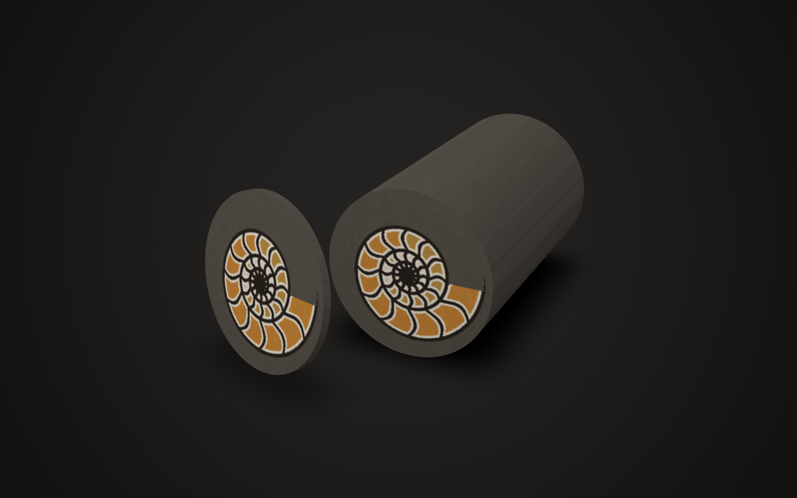
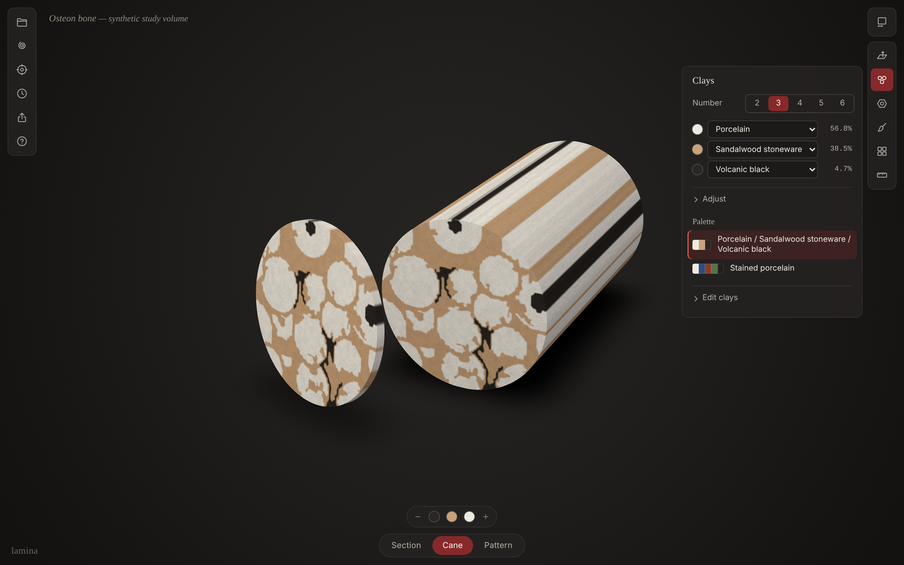
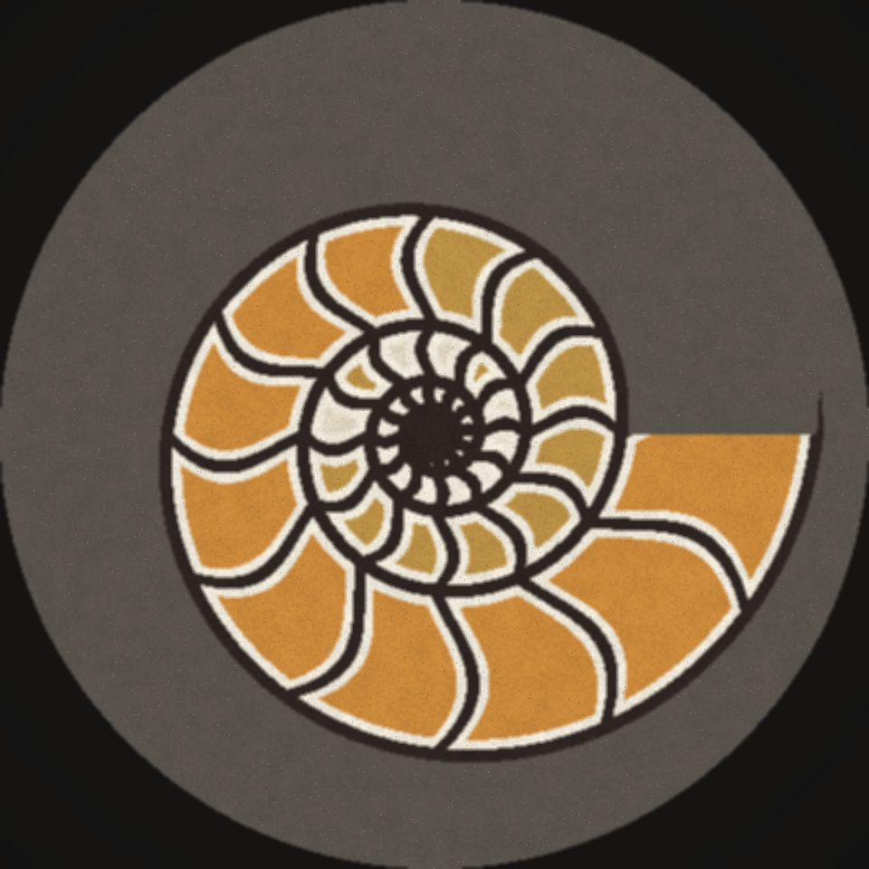
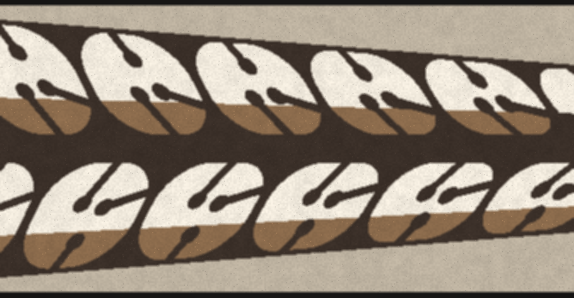

# Lamina



Lamina designs nerikomi clay canes from fossils. Start from a CT scan, a 3D model, a photograph of a polished section or a fossil template. Cut a section, choose your clays, and print a 1:1 build sheet with the weight of each clay, the size of every part, and a check that your clays will shrink together.

**[Open Lamina](https://salma2vec.github.io/lamina/)** in a browser. There is nothing to install and no account. Files you open stay on your computer.

I made Lamina for my own ceramics: nerikomi pieces built from fossil structures such as bone osteons, ammonite septa and stromatolite layers. In nerikomi the pattern runs through the clay, the way structure runs through a fossil, so a section through a specimen maps onto a cane quite directly.

## How it works

```
CT scan · 3D model · photo · template
        │
        ▼  cut a plane at any angle
   section
        │
        ▼  reduce to 2–6 clays, merge anything too thin to build
   cane
        │
        ▼  reduce, slice, tile
   pattern on a slab or vessel
        │
        ▼
   build sheet: 1:1 template, grams per clay, parts, fired size
```

Three views carry the work. **Section** shows the specimen in 3D with the cut face exposed. **Cane** shows the result as a clay log with one slice cut from the end. **Pattern** lays the slices onto a slab or a bowl. Settings live in small panels at the edges of the screen and stay closed until you need them. Section and Cane also have a flat view with a scale bar, for measuring.



| Key | Action |
| --- | --- |
| `1` `2` `3` | Section, Cane, Pattern |
| `V` | Flat or 3D view |
| `F` | Frame the object |
| `↑` `↓` | Move the plane (Shift for larger steps) |
| `←` `→` | Tilt the plane (Shift for the second axis) |
| `[` `]` | Slice thickness in Section; number of clays in Cane and Pattern |
| `R` | Random plane |
| `T` | Today |
| `S` / `E` | Save session / Export |
| `?` | Help |
| `Esc` | Close a panel, or cancel a load |

## Templates

Some fossils are better drawn than scanned. A template builds the section from a few measurements and also writes the assembly: how many sub-canes, what size, in what order.

| | |
|---|---|
|  | **Ammonite.** A logarithmic spiral of chambers. Each chamber is a tapered wedge wrapped in a lining sheet and a septa sheet, laid around a protoconch coil from smallest to largest and wrapped in matrix. Set whorls, chambers per turn, sheet thicknesses, septa curve, body chamber and how the chamber clays are placed. |
|  | **Nerinea.** A lengthwise section of a high-spired Mesozoic gastropod. Whorl chambers sit on both sides of the columella, with columellar, parietal and palatal folds and a sediment line in each chamber. Set whorls, taper, suture slope, plaits, plait depth and sediment level. |

[docs/TEMPLATES.md](docs/TEMPLATES.md) explains the geometry of each template, how to build it, and how to add your own.

## Study volumes and daily practice

Five synthetic study volumes are built in: osteon bone, ammonite, stromatolite, petrified wood and an Ediacaran rangeomorph frond. They are generated in the browser from a fixed seed and labelled as synthetic.

**Today** gives everyone the same specimen and section each day. Set a timer, design the cane by hand, then reveal Lamina's version and compare.

## Getting fossil data

Open scans are available from MorphoSource, Smithsonian 3D, Dryad, Zenodo and others. Each record has its own licence. Some do not allow commercial use, which matters if you sell what you make. [docs/DATA.md](docs/DATA.md) covers where to look, how to convert DICOM and other formats, and how to credit a specimen.

## Supported formats

| Kind | Files | Notes |
| --- | --- | --- |
| Mesh | `.stl` | Binary and ASCII. Units are taken as millimetres; you can change the unit size. |
| Mesh | `.ply` | ASCII and binary, either byte order. Polygons are triangulated. Point clouds are rejected. |
| Mesh | `.obj` | Vertices and faces. `v/vt/vn` syntax and negative indices work. |
| Volume | `.nrrd` | Attached data, raw or gzip. Integer and float types. Voxel size from `space directions` or `spacings`, in `space units`. |
| Volume | `.tif` stack | 8, 16 or 32-bit, greyscale or RGB. Uncompressed, LZW or PackBits. Voxel size from ImageJ metadata or resolution tags. |
| Volume | `.png` / `.jpg` / `.tif` slices | One file per slice, sorted in natural order (`slice2` before `slice10`). |
| Image | one `.png`, `.jpg`, `.webp` or `.tif` | A photographed section. Goes straight to the cane. Set the pixel size for millimetres. |
| Session | `.json` | Parameters and a reference to the source. Source data is never stored. |

Volumes are reduced to at most 256 voxels a side in a worker, and intensities are clipped to the 0.1–99.9 percentile range.

## The numbers

Symbols: cane size at build *D* (mm), length at build *L* (mm), reduced size *d* (mm), wet density *ρ* (g/cm³, default 1.9), waste allowance *w* (%, default 10), shrinkage of clay *i* *sᵢ* (%).

```
R           = D / d                                   reduction ratio
L_reduced   = L × R²                                  volume is conserved
mᵢ          = fᵢ × A × L / 1000 × ρ × (1 + w/100)     grams of clay i, fᵢ = its share of the section
t_reduced   = t_build / R                             thinnest region after reduction
fired sizeᵢ = d × (1 − sᵢ/100)
```

*A* is the outline area (circle, square, hexagon, triangle or loaf). The thinnest region *t* is the diameter of the largest circle that fits inside the narrowest clay region, found with an exact Euclidean distance transform. Lamina warns when *t_reduced* falls below 1 mm and when the clays in use differ in shrinkage by more than 1.5 percentage points. That limit is a working default; no published standard sets it.

The printed build sheet carries a 100 mm ruler. Measure it after printing to confirm the scale. In Chrome it prints within 0.01 mm on A4 and Letter.

[docs/CERAMICS.md](docs/CERAMICS.md) covers building the cane from the sheet, measuring your own shrinkage and density, testing clay compatibility, translucent porcelain and studio safety.

## Under the hood

- Plain HTML, CSS and ES modules. No build step, no framework, no runtime network requests. three.js and UTIF are vendored.
- Parsing, downsampling and synthetic volumes run in module workers, with progress and cancel. A 210 MB TIFF stack loads in about 3 s.
- Mesh sections are exact plane–triangle intersections on welded edges, joined into closed loops and filled even-odd. Open and non-manifold meshes are repaired at the plane.
- Volume sections are resampled on any oblique plane with trilinear interpolation, with an optional mean or maximum slab.
- Clay levels come from k-means thresholds on the section histogram. Clean-up is a majority filter, open/close, label-preserving smoothing and a minimum-width pass that merges every region narrower than you can build.
- Templates rasterise an analytic label function with 3 × 3 supersampling and majority vote, so walls one sheet thick stay continuous.
- Volume surfaces are built with surface nets in a worker, closed at the volume edge. The far side of the cutting plane is clipped so the cut face shows.
- 91 unit tests run under `node --test` with no dependencies.

## Run it locally

```sh
git clone https://github.com/salma2vec/lamina
cd lamina
python3 -m http.server 8000     # then open http://localhost:8000
npm test                        # node --test, no install needed
```

[CONTRIBUTING.md](CONTRIBUTING.md) has the folder map, design rules and open work.

## Limitations

- Volumes are capped at 256 voxels a side. Detail finer than that needs a cropped region of the scan.
- NRRD space directions set the voxel size but not the orientation. A scan with flipped axes can appear mirrored.
- Deflate TIFF, BigTIFF, detached `.nhdr` and DICOM are not read directly. [docs/DATA.md](docs/DATA.md) shows how to convert them.
- Mesh sections give two clays by default, inside and outside.
- Print scale is checked in Chrome only.

## Licence

Code is MIT. Scans you load keep their own licences.
