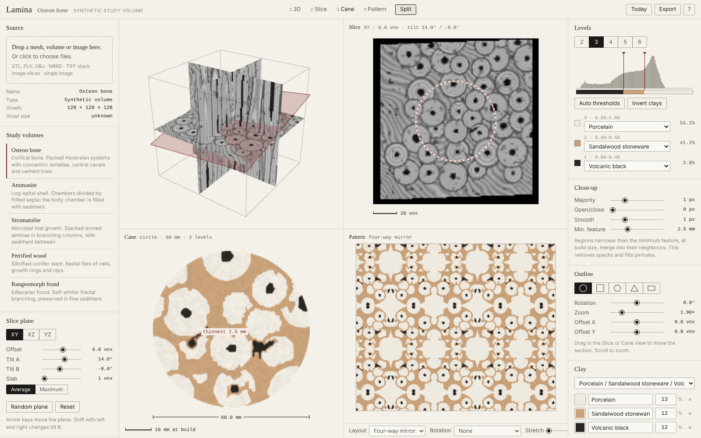

# Lamina

Lamina turns fossil CT scans and 3D meshes into nerikomi cane designs. You load a volume, a mesh or a photographed thin section and cut it with a plane. Lamina sorts the section into two to six coloured clays, cleans it up to a size you can build, crops it to a cane outline and tiles the slices into a pattern. It then prints a 1:1 build sheet with clay masses, reduction and shrinkage. It runs in the browser from static files, with no build step and no network access. Five synthetic study volumes and a daily practice mode are included.



## Features

- **Sources.** STL, PLY and OBJ meshes. NRRD volumes, multi-page TIFF stacks and numbered image slices. A single image, such as a photographed thin section, goes straight to the cane step. Large volumes are downsampled to at most 256 voxels per side in a background worker.
- **Synthetic study volumes.** Osteon bone, ammonite, stromatolite, petrified wood and a rangeomorph frond. Each is generated from a fixed seed, so everyone sees the same volume. They are labelled "synthetic study volume" and are not derived from real specimens.
- **3D view.** Meshes with a matte clay material, or volumes as three orthogonal slices. The cutting plane is a translucent quad. You set its axis, offset and two tilt angles with sliders or the arrow keys.
- **Slice.** Exact plane and mesh intersection, filled with the even-odd rule. Open or non-manifold meshes are repaired at the plane. Volumes are resampled with trilinear interpolation, with an optional slab (average or maximum over up to 32 voxels). The scale bar is in millimetres when the voxel size is known.
- **Cane design.** A histogram with draggable thresholds. Clean-up with a majority filter, open and close, boundary smoothing and a minimum feature width: narrower regions merge into their neighbours. Circle, square, hexagon, triangle and loaf outlines, with rotation, zoom and offset. Drag in the Slice or Cane view to move the section.
- **Clay palettes.** "Porcelain / Sandalwood stoneware / Volcanic black", "Stained porcelain", or your own list of two to six clays with name, colour and shrinkage. The cane is drawn with a light clay texture.
- **Pattern.** Grid, brick, hex pack, four-way mirror and radial layouts. Rotation alternation, stretch along an axis, jitter and gap. Preview on a flat slab or on a vessel.
- **Build sheet.** Reduction ratio, length after reduction, thinnest region at build, reduced and fired size, area share and wet mass per clay, fired size, and a warning when clay shrinkages differ by more than 1.5 percentage points.
- **Exports.** SVG of the cross-section at true 1:1 scale in millimetres, with key, scale bar and dimensions. PNG of the cane and of the pattern. A printable build sheet for A4 or Letter. Session files in JSON.
- **Today.** A date-seeded study: the same specimen and plane for everyone on a given day, a 5, 10, 20 or 30 minute timer, and a Reveal button that shows Lamina's own cane for comparison.
- **Offline.** No requests leave the page. On HTTPS hosts, a service worker keeps a copy for offline use after the first visit.

## Quick start

Clone or download the repository, then serve the folder:

```sh
cd lamina
python3 -m http.server 8000
```

Open <http://localhost:8000>. Any static file server works. Browsers block ES modules and workers on `file://` URLs, so opening `index.html` directly does not work.

To publish on GitHub Pages, enable Pages for the repository and choose the default branch and the root folder. No build is needed.

Lamina needs a current browser with ES modules, module workers, `OffscreenCanvas` and `DecompressionStream`: Chrome or Edge 98+, Firefox 114+, Safari 16.4+. The 3D view needs WebGL. The other views work without it.

## Supported formats

| Kind | Extensions | Notes |
| --- | --- | --- |
| Mesh | `.stl` | Binary and ASCII. Units are taken as millimetres. You can change the unit size. |
| Mesh | `.ply` | ASCII, binary little-endian and binary big-endian. Polygons are triangulated. Point clouds are rejected. |
| Mesh | `.obj` | Vertices and faces only. `v/vt/vn` syntax and negative indices are supported. |
| Volume | `.nrrd` | Attached data only, raw or gzip encoding. Types uint8, int8, uint16, int16, uint32, int32, float32, float64. Voxel size from `space directions` or `spacings`. |
| Volume | `.tif`, `.tiff` (multi-page) | 8, 16 or 32-bit greyscale or RGB. Uncompressed, LZW or PackBits. Deflate and BigTIFF are not supported. |
| Volume | several `.png`, `.jpg`, `.tif` files | One file per slice, sorted by name in natural order (`slice2` before `slice10`). All slices must have the same size. |
| Image | single `.png`, `.jpg`, `.webp`, or one-page `.tif` | Goes straight to the cane step. Set the pixel size to get a scale bar in millimetres. |
| Session | `.json` | Saved from Lamina. Holds parameters and a reference to the source, not the source data. |

Volumes larger than 256 voxels on a side are box-filtered by an integer factor per axis. Intensities are clipped to the 0.1 and 99.9 percentiles. [docs/DATA.md](docs/DATA.md) lists open sources of fossil scans and explains how to convert DICOM series and other formats.

## How the build sheet works

Symbols: cane size at build *D* (mm, the outline width), cane length at build *L* (mm), reduced size *d* (mm), wet density *ρ* (g/cm³), waste allowance *w* (%), shrinkage of clay *i* *sᵢ* (%).

**Reduction**

```
R = D / d                        linear reduction ratio
L_reduced = L × R²               volume is conserved
```

**Outline area** (D is the width of the outline's bounding box)

```
circle      A = π D² / 4
square      A = D²
hexagon     A = (3√3 / 8) D²     D measured across corners
triangle    A = (√3 / 4) D²      equilateral, D is the side
loaf        A = D × (a D)        a is the height-to-width ratio
```

**Clay mass**

```
fᵢ = pixels of clay i / pixels inside the outline
mᵢ = fᵢ × A × L / 1000 × ρ × (1 + w / 100)      grams
```

Two levels mapped to the same clay are added together.

**Thinnest region.** For each connected region of one clay, Lamina finds the largest circle that fits inside it with an exact Euclidean distance transform. The region's width is the diameter of that circle. The cane outline does not count as a boundary, so a region cut by the outline is measured by its inner extent. The thinnest region is the smallest such width:

```
t_build   = smallest region width × D / grid size
t_reduced = t_build / R
t_fired   = t_reduced × (1 − max sᵢ / 100)
```

Lamina warns when *t_reduced* is below the "Warn below" value (1.0 mm by default). The clean-up step merges every region narrower than the minimum feature into its neighbours, so *t_build* is at least that value when clean-up is on.

**Fired size and compatibility**

```
fired sizeᵢ = d × (1 − sᵢ / 100)
warn when max sᵢ − min sᵢ > 1.5 percentage points (over the clays in use)
```

The 1.5-point limit is a starting point, not a standard. [docs/CERAMICS.md](docs/CERAMICS.md) explains how to build a cane from the sheet, how to measure shrinkage and density, and how to test clay compatibility before you commit to a piece.

## Keyboard

| Key | Action |
| --- | --- |
| `1` to `4` | 3D, Slice, Cane, Pattern |
| `G` | All four views |
| `↑` `↓` | Move the plane along its normal (Shift for larger steps) |
| `←` `→` | Tilt A (Shift for tilt B) |
| `[` `]` | Slab thickness in Slice and 3D; number of clay levels in Cane and Pattern |
| `R` | Random plane |
| `T` | Today |
| `S` | Save session |
| `E` | Export menu |
| `?` | Shortcut list |

## Development

```sh
npm test            # node --test tests/*.test.js
npm run serve       # python3 -m http.server 8000
```

There is no build and there are no runtime dependencies to install. The tests use only Node's built-in test runner (Node 20 or later). See [CONTRIBUTING.md](CONTRIBUTING.md) for the folder map, design rules and how to submit a change.

## Known limitations

- Volumes are capped at 256 voxels per side after downsampling. Fine structure in large scans is averaged away.
- Detached NRRD (`.nhdr` with a separate data file), DICOM, Deflate-compressed TIFF and BigTIFF are not read directly. [docs/DATA.md](docs/DATA.md) shows how to convert them.
- Mesh sections are binary (inside or outside). A mesh gives a two-clay cane unless you add levels by hand.
- The cane grid is 320 × 320 pixels. At a 60 mm cane, one pixel is about 0.19 mm.
- Mass and fired size are estimates. They assume even reduction and even shrinkage.

## Licence

MIT. See [LICENSE](LICENSE). Vendored libraries keep their own licences: three.js (MIT) and UTIF.js (MIT). See [vendor/README.md](vendor/README.md).
